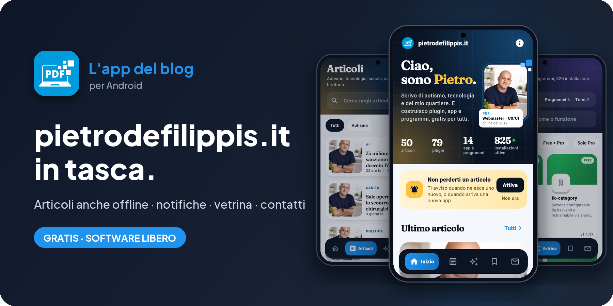
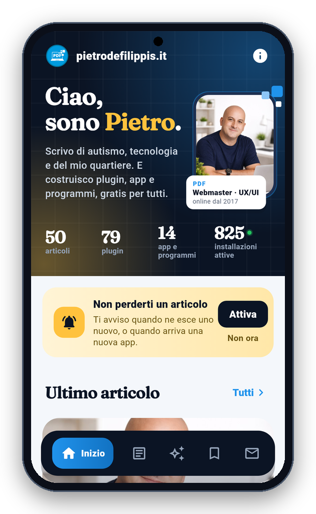
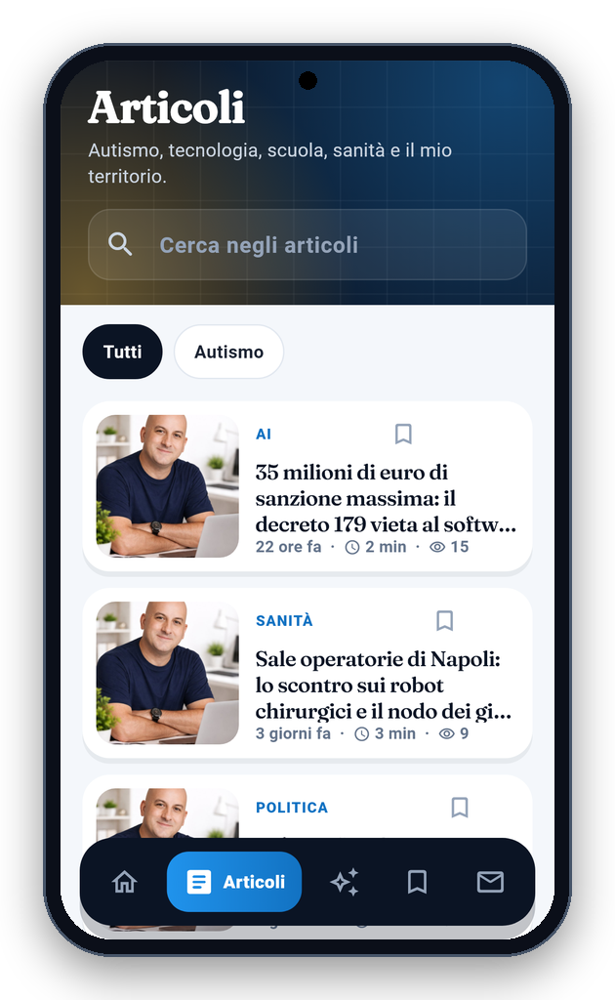
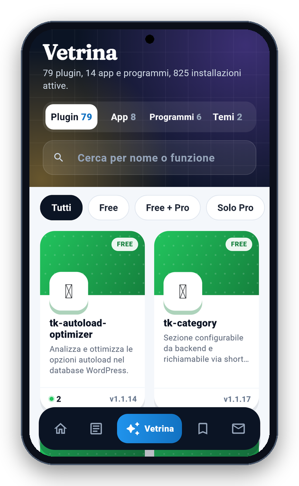
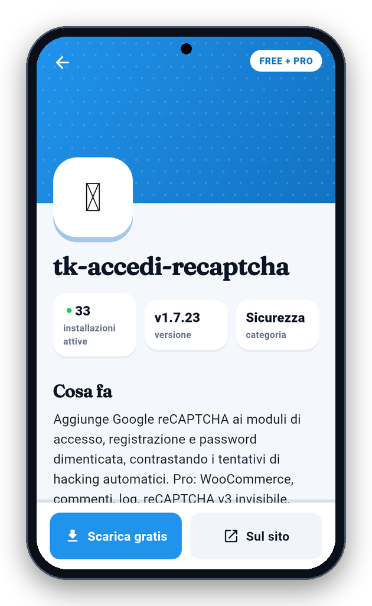
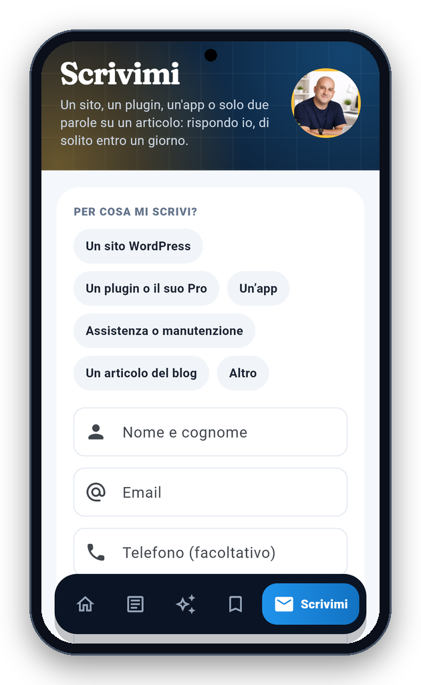

<!-- README generato da Dropbox/CLAUDE/dev/agpl-rollout/readme/genera_readme_app.py: modificare lì -->
<div align="center">



<br><br>

<a href="https://pietrodefilippis.it/scarica-app/tk-pietro/"></a> &nbsp; <a href="https://pietrodefilippis.it/donazione/"></a>

<br><br>

<a href="COPYING"></a>   

</div>

---

## ✨ Cosa fa

<table>
<tr>
<td width="50%" valign="top">

### 📰&nbsp; Gli articoli del blog
Autismo, tecnologia, scuola, sanità e territorio.

</td>
<td width="50%" valign="top">

### 📴&nbsp; Anche senza internet
Gli articoli salvati si leggono ovunque.

</td>
</tr>
<tr>
<td width="50%" valign="top">

### 🔔&nbsp; Notifiche
Sai subito quando esce un articolo nuovo.

</td>
<td width="50%" valign="top">

### 🧩&nbsp; Vetrina
Plugin WordPress, app e programmi, con le installazioni attive.

</td>
</tr>
<tr>
<td width="50%" valign="top">

### ✉️&nbsp; Scrivimi
Il modulo per contattarmi, direttamente dall'app.

</td>
<td width="50%" valign="top">

### 🙅&nbsp; Nessun account
Niente registrazioni, niente servizi esterni, niente pubblicità.

</td>
</tr>
</table>

## 📱 Com'è fatta

<div align="center">

<table align="center">
<tr>
<td align="center" valign="top"><br><sub><b>Inizio</b></sub></td>
<td align="center" valign="top"><br><sub><b>Articoli</b></sub></td>
<td align="center" valign="top"><br><sub><b>Lettore</b></sub></td>
</tr>
<tr>
<td align="center" valign="top"><br><sub><b>Vetrina</b></sub></td>
<td align="center" valign="top"><br><sub><b>Scheda plugin</b></sub></td>
<td align="center" valign="top"><br><sub><b>Scrivimi</b></sub></td>
</tr>
</table>

</div>

## 🔒 I tuoi dati

- **Privacy:** articoli salvati, letti e impostazioni restano sul telefono. Le notifiche nascono da un controllo del sito fatto dal telefono circa una volta all'ora: nessun servizio esterno, nessun account. Il modulo Contatti manda nome, email e messaggio solo a pietrodefilippis.it. Le statistiche anonime (una volta al giorno: nome, versione, sistema e un codice casuale) partono solo se dici sì nel benvenuto o in Informazioni.

Nessuna pubblicità, nessun account da creare, nessun abbonamento: tutte le funzioni sono gratis, per tutti.

## 📥 Installazione

- **Android** — [scarica l'app](https://pietrodefilippis.it/scarica-app/tk-pietro/) da pietrodefilippis.it e aprila: Android chiede una volta il permesso di installare app da questa origine. Gli aggiornamenti arrivano da soli, l'app te li propone. A breve anche su Google Play.
- **Piattaforme:** Android; iPhone in arrivo.

<details>
<summary><b>🛠️ Compilare dal codice sorgente</b></summary>

<br>

Serve [Flutter](https://flutter.dev) (versione indicata in `.github/workflows/android.yml`):

```bash
flutter pub get
flutter test
flutter build apk --release
```

Senza la variabile `ANDROID_KEYSTORE` l'APK si firma con la chiave di debug di Flutter.

</details>

## 📜 Licenza

**pietrodefilippis.it** è software libero: © 2026 Pietro De Filippis (TecnikGeek), licenza
**[GNU Affero General Public License v3.0](COPYING)**. Puoi usarlo, studiarlo, modificarlo e condividerlo; è
fornito **così com'è, senza alcuna garanzia**.

> Il carattere Fraunces è sotto [SIL Open Font License](assets/font/OFL.txt). Il nome «pietrodefilippis.it», il logo e la foto non sono coperti dalla licenza (AGPL sez. 7): una versione modificata deve avere un nome e un'immagine diversi.

---

<div align="center">

**Ti è utile?** Tutte le funzioni sono gratis per tutti. Se vuoi, un caffè aiuta a migliorarla e a crearne altre.

<a href="https://pietrodefilippis.it/donazione/"></a>

<sub>Creata da <a href="https://pietrodefilippis.it">Pietro De Filippis · TecnikGeek</a> — Webmaster & UX/UI Designer</sub>

</div>
